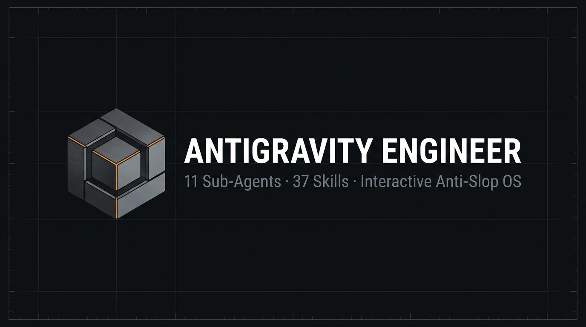
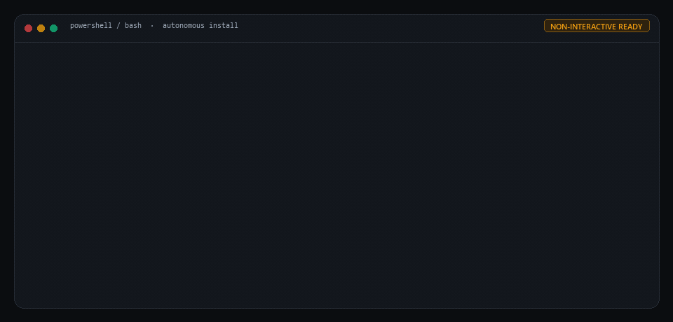
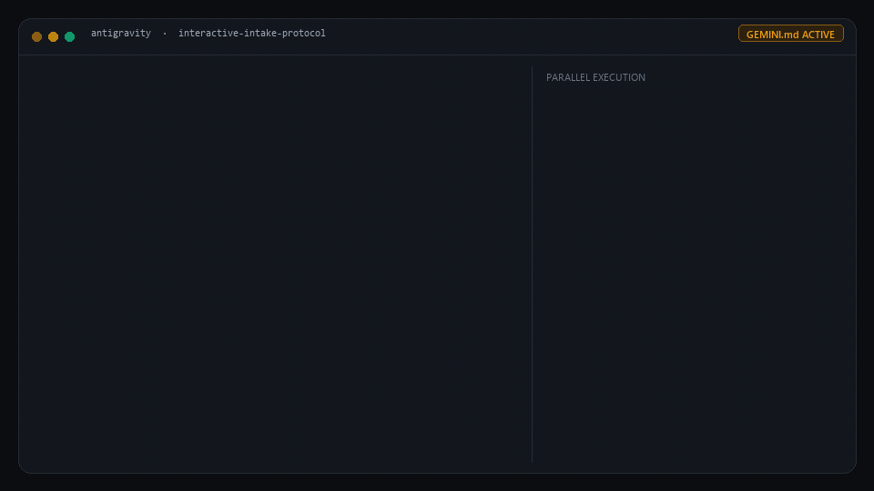
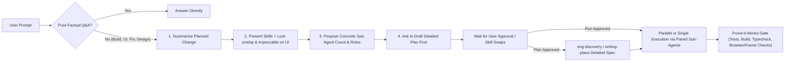
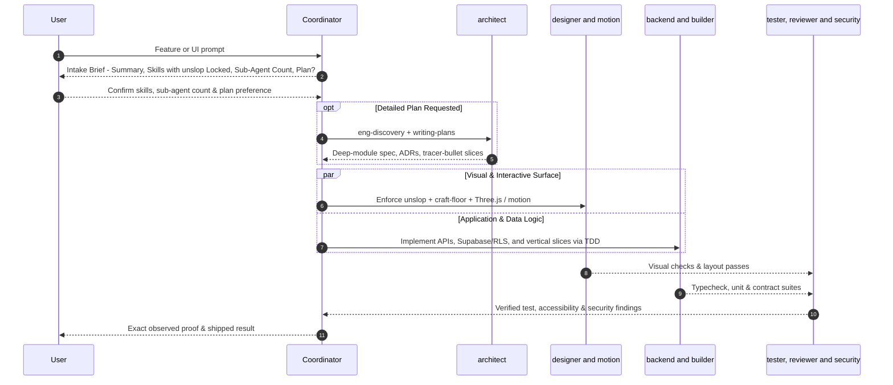
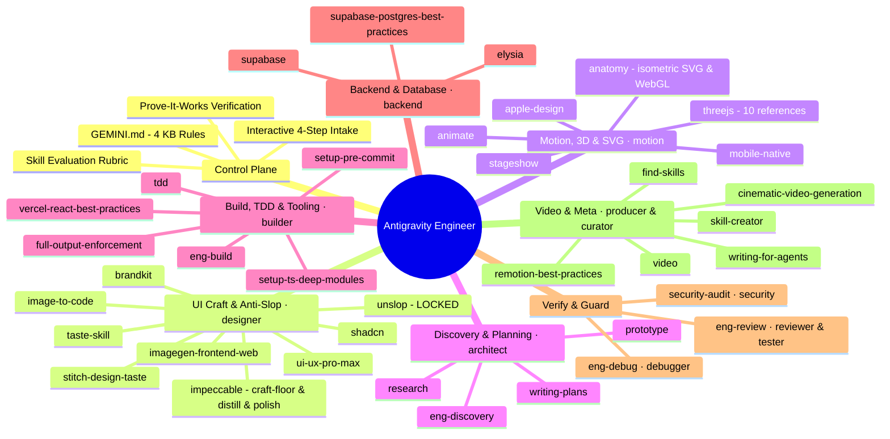

<div align="center">



<br />

[](#complete-catalog-of-all-37-unified-skills)
[](#the-11-simplified-sub-agents)
[](#ecosystem-mind-map--visual-architecture)
[](#how-the-interactive-pre-execution-protocol-works)
[](#autonomous-ai-agent-install)

<p>
  <strong>A unified, zero-slop global operating system for Antigravity IDE agents.</strong><br />
  Everything ships as standalone skills, simple 1-word sub-agents, and an interactive intake gate—no external plugins or guesswork required.
</p>

<p>
  <a href="#autonomous-ai-agent-install">Quick Install</a> &nbsp;·&nbsp;
  <a href="#how-the-interactive-pre-execution-protocol-works">Interactive Protocol</a> &nbsp;·&nbsp;
  <a href="#ecosystem-mind-map--visual-architecture">Mind Maps</a> &nbsp;·&nbsp;
  <a href="#the-11-simplified-sub-agents">11 Sub-Agents</a> &nbsp;·&nbsp;
  <a href="#complete-catalog-of-all-37-unified-skills">37 Skills</a> &nbsp;·&nbsp;
  <a href="#backup-upgrades--prerequisites">Backup & Tools</a>
</p>

</div>

---

## Autonomous AI Agent Install

> [!IMPORTANT]
> **One-Prompt Install for AI Agents:** Copy and send this single instruction to Antigravity in any conversation:
> *"Clone `https://github.com/itsjamiedev/Antigravity-Engineer.git` and follow `README.md` to install it globally using clean non-interactive mode, then verify all completion criteria pass."*

<div align="center">
  
</div>

### 1. Decide Install Scope
1. **Global Install (`~/.gemini/config/`) — Default Recommended**: Installs `GEMINI.md`, all `37` skills, and all `11` sub-agents globally so every workspace inherits them automatically.
2. **Global + Workspace Mirror (`-Workspace` / `--workspace`)**: Installs globally **and** copies `skills/` into `<project>/.agents/skills/` when a repository needs local skills tracked in Git.
3. **Workspace-Only (`-WorkspaceOnly` / `--workspace-only`)**: Deploys `skills/` solely into `<project>/.agents/skills/` without touching global configuration.

### 2. Run Non-Interactive Installer

#### Windows (PowerShell)
```powershell
git clone https://github.com/itsjamiedev/Antigravity-Engineer.git
cd Antigravity-Engineer

# Clean global install (recommended — backs up existing config first)
powershell -ExecutionPolicy Bypass -File .\install.ps1 -CleanOldSkills -NonInteractive

# Merge install (keep unrelated custom skills in ~/.gemini/config/skills)
powershell -ExecutionPolicy Bypass -File .\install.ps1 -Merge -NonInteractive

# Global install + also copy all 37 skills into a specific project workspace
powershell -ExecutionPolicy Bypass -File .\install.ps1 -CleanOldSkills -NonInteractive -Workspace "C:\path\to\project"

# Deploy into one workspace only (requires -Workspace)
powershell -ExecutionPolicy Bypass -File .\install.ps1 -WorkspaceOnly -Workspace "C:\path\to\project" -NonInteractive
```

#### macOS / Linux / Git Bash
```bash
git clone https://github.com/itsjamiedev/Antigravity-Engineer.git
cd Antigravity-Engineer
chmod +x ./install.sh

# Clean global install (recommended — backs up existing config first)
./install.sh --clean-old-skills --non-interactive

# Merge install (keep unrelated custom skills)
./install.sh --merge --non-interactive

# Global install + copy skills into a specific project workspace
./install.sh --clean-old-skills --non-interactive --workspace "/path/to/project"

# Deploy into one workspace only
./install.sh --workspace-only --workspace "/path/to/project" --non-interactive
```

<details>
<summary><strong>Manual Copy Fallback & Mandatory Agent Verification Checklist (click to expand)</strong></summary>

#### Manual File Installation (If Script Execution Is Restricted)
1. Copy `GEMINI.md` to `~/.gemini/config/GEMINI.md`.
2. If upgrading from an older version of `antigravity-engineering-os`, remove the 11 legacy hyphenated sub-agent files from `~/.gemini/config/agents/`:
   `software-architect.md`, `backend-systems-engineer.md`, `desktop-app-engineer.md`, `ui-ux-designer.md`, `motion-design-engineer.md`, `deep-debugger.md`, `code-reviewer.md`, `qa-automation-engineer.md`, `security-auditor.md`, `video-production-engineer.md`, `skill-architect.md`.
3. Copy all `11` `.md` files from `agents/` into `~/.gemini/config/agents/`.
4. Copy all `37` directories from `skills/` into `~/.gemini/config/skills/` (or `<workspace>/.agents/skills/`).

#### Mandatory Completion Criteria (Verify Before Reporting Done)
| Check | Expected Pass Condition |
| :--- | :--- |
| Global or target `skills/` count | `>= 37` directories, every one containing a `SKILL.md` file with YAML `name:` and `description:` |
| Global `agents/` roster | `11` simple 1-word `.md` profiles present; `0` legacy hyphenated agent filenames left behind |
| Global `GEMINI.md` | Present at `~/.gemini/config/GEMINI.md`, plain Markdown (no YAML frontmatter), `< 24000` bytes |
| Installer process | Exited with code `0` and printed verified counts |

</details>

---

## How the Interactive Pre-Execution Protocol Works

Unlike silent agents that guess requirements and dump generic boilerplate, **`GEMINI.md` enforces an interactive 4-step intake pause before planning or touching code** on every non-trivial task.

<div align="center">
  
</div>

### Request Lifecycle (`GEMINI.md` Pipeline)



### Multi-Agent Collaboration Flow



> [!TIP]
> **Why `unslop` + `impeccable` Are Locked on UI Tasks:** You never have to remember slash commands like `/distill` or `/polish` before designing a screen. On every UI task, the intake gate automatically announces *"We're also pairing the `unslop` skill (+ `impeccable` guardrails) on this UI work"* with zero opt-out—eliminating glowing purple templates, nested card-in-card clutter, decorative blurs, and uneven spacing by default.

---

## Ecosystem Mind Map & Visual Architecture

Everything connects cleanly under one 4 KB global rule file (`GEMINI.md`): **`11` simple 1-word sub-agents** dispatch **`37` standalone skills** across **`8` domains**, with **`0` external plugins required**.

<div align="center">
  
</div>

### Interactive Full Mind Map (`37` Skills + `11` Sub-Agents)



---

## The `11` Simplified Sub-Agents

Every sub-agent uses a short, memorable 1-word name (`agents/<name>.md`) wired directly to specific skills and verification gates—replacing long multi-word names across the entire OS.

| Sub-Agent | Role | Core Skills Paired | Verification Contract |
| :--- | :--- | :--- | :--- |
| **`architect`** | Systems architect & planner | `eng-discovery`, `writing-plans`, `prototype` | Contracts & file refs verified against live codebase |
| **`backend`** | APIs, Postgres & realtime WS | `eng-build`, `tdd`, `elysia`, `supabase`, `supabase-postgres-best-practices` | Integration tests, query/schema checks, live endpoints |
| **`builder`** | Full-stack & desktop slices | `eng-build`, `tdd`, `full-output-enforcement`, `vercel-react-best-practices`, `setup-ts-deep-modules` | Typecheck, lint, TDD suites & IPC isolation checks |
| **`designer`** | Visual UI/UX & anti-slop lead | `unslop` *(locked)*, `impeccable`, `taste-skill`, `ui-ux-pro-max`, `shadcn` | Browser screenshot/frame review + zero slop tells |
| **`motion`** | Animation, 3D WebGL & SVGs | `animate`, `anatomy`, `apple-design`, `mobile-native`, `stageshow`, `threejs` | `film.mjs --gate`, `anatomy --audit` + `lines.mjs`, disposal |
| **`debugger`** | Root-cause diagnostics | `eng-debug` | 1–5s deterministic repro red -> green + `blast-radius` |
| **`reviewer`** | Code quality & spec audit | `eng-review` | Evidence-backed Findings (Standards + Spec axes) |
| **`tester`** | QA, E2E & TDD automation | `tdd`, `eng-review` | Real Playwright / contract / axe-core passes post-edit |
| **`security`** | Zero-trust, RLS & OWASP | `security-audit` | Schema validators (`validate-findings.cjs`, `validate-coverage-ledger.cjs`) |
| **`producer`** | Remotion & explainer video | `remotion-best-practices`, `cinematic-video-generation`, `video` | Timeline/audio audit + preview frames / CRF 14 render |
| **`curator`** | Skills, rules & repo hygiene | `skill-creator`, `writing-for-agents`, `find-skills`, `agy-customizations` | Frontmatter, broken link checks & 24 KB rule limit |

<details>
<summary><strong>Deep Dive: What Each Sub-Agent Owns, Triggers & Verifies (click to expand any role)</strong></summary>

### Planning, Design & Motion
- **`architect`** (`agents/architect.md`) — Turns vague prompts into crisp domain models (`GLOSSARY.md`), deep modules with small seams (Ousterhout philosophy), Architecture Decision Records (`ADRs`), and tracer-bullet implementation tickets. Never speculates about interfaces without reading the live codebase first.
- **`designer`** (`agents/designer.md`) — Builds typography hierarchies, clean Tailwind/shadcn layouts, and calibrated color systems while enforcing **`unslop`** and **`impeccable`** (`craft-floor`, `distill`, `polish`). Hands off WebGL/Three.js scenes, custom motion choreography, and interactive SVG explainers to `motion`.
- **`motion`** (`agents/motion.md`) — Specializes in restrained UI transitions (`animate`), interruptible pointer-driven springs (`apple-design`), touch/viewport ergonomics (`mobile-native`), cursor product demos (`stageshow`), precision isometric mechanical SVG figures with depth-sorted geometry (`anatomy`), and full 3D WebGL scenes (`threejs`).

### Implementation & Backend
- **`backend`** (`agents/backend.md`) — Builds strictly typed ElysiaJS/Hono endpoints with TypeBox/Zod validation (`Eden Treaty`), tunes PostgreSQL/Supabase queries (`EXPLAIN (ANALYZE, BUFFERS)`, GIN/`jsonb_path_ops` indexes), configures RLS-safe pooling, and builds reconnect-safe WebSocket gateways.
- **`builder`** (`agents/builder.md`) — Ships complete, non-stubbed (`full-output-enforcement`) vertical slices across Next.js/React frontends, TypeScript deep modules, and secure Electron/desktop runtimes (`nodeIntegration: false`, `contextIsolation: true`, typed `contextBridge` IPC).

### Quality, Security, Media & Governance
- **`debugger`** (`agents/debugger.md`) — Investigates commit history (`why`), isolates failures in 1–5 second deterministic reproduction loops, tracks forced DOM layout thrashing and memory leaks, runs `attack-the-premise` if two fixes fail, and verifies callers (`blast-radius`).
- **`reviewer`** (`agents/reviewer.md`) — Runs two-axis reviews (**Standards Axis**: Fowler smells, React waterfalls, WCAG 2.2 accessibility; **Spec Axis**: zero requirement drift or refactor avalanches), organizing output cleanly into Strengths, Suggestions, and Blockers.
- **`tester`** (`agents/tester.md`) — Drives strict Red-Green-Refactor TDD, authors resilient Playwright locators (`getByRole`, `getByLabel`), validates REST/WebSocket schemas, and runs automated accessibility sweeps.
- **`security`** (`agents/security.md`) — Audits server-side auth (`auth.getUser()` vs cached session), PostgreSQL Row Level Security (`(SELECT auth.uid())`), OWASP API Top 10 (BOLA/BFLA, race conditions with `SELECT ... FOR UPDATE`), and Cloudflare's 6-phase security workflow.
- **`producer`** (`agents/producer.md`) — Orchestrates programmatic React video compositions (`remotion-best-practices` 12-in-1 router) and 2D animated explainers with voiceover/SFX pipelines (`cinematic-video-generation`).
- **`curator`** (`agents/curator.md`) — Audits candidate skills against the 4-point Skill Evaluation Rubric, prunes duplicates, keeps `GEMINI.md` under 24 KB without YAML frontmatter, and validates script tests and relative links.

</details>

---

## Complete Catalog of All `37` Unified Skills

Every skill folder lives directly under `skills/<name>/SKILL.md` with progressive disclosure (`references/`, `scripts/`, `kit/`, `examples/`) loaded strictly on demand. Click any domain drawer below to inspect every skill inside.

<details open>
<summary><strong>1. UI Craft & Anti-Slop Design Systems (9 Skills · Paired with <code>designer</code>)</strong></summary>

| Skill | What It Does | When It Activates |
| :--- | :--- | :--- |
| **`unslop`** *(Locked)* | 9-pass redline cleanup (4px spacing rhythm, single neutral ramp, single accent contrast, copy tightening, zero purple gradients/glows/emoji slop). Includes `scripts/snapshot.mjs` to capture live sites before polishing. | Automatically paired on **every** UI build, polish, or redesign prompt with zero opt-out. |
| **`impeccable`** | Full design lifecycle framework (`craft-floor`, `distill` to strip bloat/cards, `polish`, `audit`, `critique`, `harden`, `bolder`, `quieter`, `live`). | Automatically enforces `craft-floor` bans alongside `unslop` on UI tasks. |
| **`taste-skill`** | Adjustable layout, visual variance, density, and motion intensity framework tailored for company/product websites at modern production bar. | New landing pages, product sites, or stylistic overhauls. |
| **`ui-ux-pro-max`** | Searchable local design intelligence database (`84` styles, `192` palettes, `74` font pairings, `98` UX rules, `25` chart types, `22` framework stacks). | Choosing color systems, font pairings, chart types, or stack-specific patterns. |
| **`shadcn`** | CLI and composition patterns for `shadcn/ui` projects, `components.json` presets, component search, and debugging styling conflicts. | Adding, styling, or debugging shadcn/ui components. |
| **`stitch-design-taste`** | Semantic design-system generator outputting clean `DESIGN.md` specifications with calibrated palettes, typography scales, and hardware-accelerated motion specs. | Documenting or bootstrapping a cohesive `DESIGN.md` system. |
| **`brandkit`** | High-craft visual identity art-direction system for minimalist brand-guideline boards, logo concepts, mockups, and cohesive layout grids. | Creating brand boards, identity guidelines, or presentation visuals. |
| **`imagegen-frontend-web`** | Direction rules ensuring multi-section web comps generate dedicated compositionally varied section images with unified palettes instead of cramped grids. | Directing generated section imagery for multi-section web pages. |
| **`image-to-code`** | Converts high-resolution visual design references cleanly into responsive code without card-inside-card nesting or clipped above-the-fold heroes. | Translating screenshots, mockups, or generated page images into production UI. |

</details>

<details open>
<summary><strong>2. Animation, 3D WebGL, Isometric SVGs & Mobile (6 Skills · Paired with <code>motion</code>)</strong></summary>

| Skill | What It Does | When It Activates |
| :--- | :--- | :--- |
| **`animate`** | Decision-first UI motion framework: frequency gate (never animate high-frequency keystrokes), purpose check, cheapest mechanism (`CSS` -> `@starting-style` -> `WAAPI` -> `Motion`), and reduced-motion hygiene. | Component entrances, transitions, state feedback, and micro-interactions. |
| **`anatomy`** | Builds physical-machine isometric SVG explainers (`kit/`, `draw.tsx`, WebGL shader integration, `A.settle` depth sorting, `--audit` geometry verifier, and `lines.mjs` check). | Interactive technical diagrams, architecture explainers, or physical-rig SVGs. |
| **`apple-design`** | Translates Apple fluid UI principles to the web: pointer-down responsiveness, velocity-preserving interruptible springs, translucent depth, and optical sizing. | Drag/swipe/sheet gestures, spring modals, and continuous physics interactions. |
| **`mobile-native`** | Eliminates "website on a phone" tells: `(hover: hover)` sticky-hover guards, `dvh` viewports, safe-area `env()` insets, 16px+ inputs preventing Safari auto-zoom, and touch callout fixes. | Responsive mobile layouts, PWAs, drawers, bottom sheets, and carousels. |
| **`stageshow`** | Faux product-UI React + CSS toolkit for still mockups, bento tiles, satellites, and choreographed cursor walkthroughs verified via `film.mjs --gate` (desktop + 390px). | Marketing feature cards, hero app previews, and product walkthrough animations. |
| **`threejs`** | Consolidated Three.js & WebGL 3D router covering **10 dedicated references**: `fundamentals`, `geometry`, `materials`, `lighting`, `textures`, `animation`, `loaders`, `shaders`, `postprocessing`, and `interaction`—plus disposal & DPR guardrails. | Any 3D canvas, GLTF model viewer, custom GLSL shader, Raycaster, or EffectComposer scene. |

</details>

<details>
<summary><strong>3. Discovery, Planning & Research (4 Skills · Paired with <code>architect</code>)</strong></summary>

| Skill | What It Does | When It Activates |
| :--- | :--- | :--- |
| **`eng-discovery`** | Structured framing (`reframe`, `sharpen`), branch interrogation (`grill-with-docs`), `GLOSSARY.md` & ADR authoring, tracer-bullet slicing, and deep-module audits. | Starting new features, untangling ambiguous requirements, or refactoring architecture. |
| **`writing-plans`** | Pre-code planning template breaking complex multi-step deliverables into verifiable phases with explicit files and acceptance checks. | Whenever detailed planning is approved during the intake gate. |
| **`prototype`** | Fast isolated throwaway prototypes (standalone HTML or isolated route) to settle competing state or UX models before touching production code. | Answering "does this model or interaction actually feel right?" empirically. |
| **`research`** | Primary-source investigation protocol verifying live docs/APIs before writing structured technical findings. | Deep library comparisons, API verification, or framework architecture research. |

</details>

<details>
<summary><strong>4. Build, TDD & Engineering Tooling (6 Skills · Paired with <code>builder</code> / <code>tester</code>)</strong></summary>

| Skill | What It Does | When It Activates |
| :--- | :--- | :--- |
| **`eng-build`** | 24 core engineering principles (`Foundational Thinking`, `Boundary Discipline`, `Type System Discipline`, `Idempotency`, `Subtract Before Adding`), clean vertical slices, and sub-agent parallelism. | Implementing features, migrations, and refactors cleanly without dead code. |
| **`tdd`** | Strict Red -> Green -> Refactor test loop prioritizing observable behavior (`tests.md`, `mocking.md`) instead of testing brittle internals. | Feature implementation, bug regression tests, and API contracts. |
| **`full-output-enforcement`** | Prohibits truncated outputs, `// TODO` stubs, or `...rest of code...` placeholders—guaranteeing complete production files. | Every implementation or code-generation task. |
| **`vercel-react-best-practices`** | Performance rulebook for React & Next.js apps covering waterfall elimination, server/client bundle splits, dynamic imports, and re-render hygiene. | Authoring or auditing React / Next.js pages, hooks, and data loaders. |
| **`setup-pre-commit`** | Configures Husky + `lint-staged` (Prettier formatting, typecheck, and automated test hooks) before commits land. | Setting up or tightening repository commit hygiene. |
| **`setup-ts-deep-modules`** | Configures `dependency-cruiser` so TypeScript packages expose strict entry-point seams while hiding internal implementation subfolders (`lib/`, `tests/`). | Enforcing modular TypeScript package boundaries in multi-module repos. |

</details>

<details>
<summary><strong>5. Backend & PostgreSQL / Supabase (3 Skills · Paired with <code>backend</code>)</strong></summary>

| Skill | What It Does | When It Activates |
| :--- | :--- | :--- |
| **`elysia`** | Type-safe backend development patterns with ElysiaJS: schema validation, plugins, lifecycle hooks, error handling, and end-to-end typed clients (`Eden Treaty`). | Creating or updating ElysiaJS routes, plugins, and services. |
| **`supabase`** | Full Supabase integration guide: SSR cookie auth (`@supabase/ssr`, `auth.getUser()`), database migrations, RLS policies, Realtime, Storage, Edge Functions, and pgvector. | Working with Supabase auth, schema migrations, edge functions, or client SSR. |
| **`supabase-postgres-best-practices`** | Query and schema optimization rules: eliminating seq scans, `EXPLAIN (ANALYZE, BUFFERS)`, GIN JSONB indexing, pooling, and lock-safe migrations. | Reviewing slow Postgres queries, table schemas, or high-concurrency writes. |

</details>

<details>
<summary><strong>6. Debugging, Code Review & Zero-Trust Security (3 Skills · Paired with <code>debugger</code> / <code>reviewer</code> / <code>tester</code> / <code>security</code>)</strong></summary>

| Skill | What It Does | When It Activates |
| :--- | :--- | :--- |
| **`eng-debug`** | Git history archaeology (`why`), 1–5s deterministic repro loops, `attack-the-premise` circuit breaker, and runtime `blast-radius` caller checks. | Hard bugs, intermittent failures, regressions, performance issues, or risky edits. |
| **`eng-review`** | Two-axis adversarial review (`interrogate`), crisp PR summaries (`pr`), post-task environment hardening (`retro`), and real command verification (`prove-it-works`). | Auditing diffs, pre-commit checks, and verifying fixes. |
| **`security-audit`** | Cloudflare's 6-phase security assessment workflow (Reconnaissance -> Coverage ledger -> Validation -> `validate-findings.cjs` -> Reporting) + targeted security reviews. | Auth/RLS audits, security reviews, threat modeling, and full pen-test style sweeps. |

</details>

<details>
<summary><strong>7. Video & Remotion Production (3 Skills · Paired with <code>producer</code>)</strong></summary>

| Skill | What It Does | When It Activates |
| :--- | :--- | :--- |
| **`remotion-best-practices`** | Consolidated 12-in-1 Remotion router covering project scaffolding, React video markup, Studio live preview, captions, maps (`Cesium`), `<Player>`, and CLI rendering. | Building programmatic videos or interactive Remotion compositions. |
| **`cinematic-video-generation`** | Full 2D animated explainer pipeline: theme tokens, brand logos, TTS/voiceover sync, multi-beat SFX, project audio/timeline audit script, and 1080p CRF 14 rendering. | Producing product launch videos, pitch explainers, or narrated walkthroughs. |
| **`video`** | Direct `/video` command wrapper triggering the cinematic 2D animated video production workflow. | Invoking video explainer generation quickly. |

</details>

<details>
<summary><strong>8. Skill Authoring & Ecosystem Maintenance (3 Skills · Paired with <code>curator</code>)</strong></summary>

| Skill | What It Does | When It Activates |
| :--- | :--- | :--- |
| **`skill-creator`** | Scaffold, optimize, benchmark, and trigger-tune new skills cleanly with YAML frontmatter and eval suites. | Building or improving custom `SKILL.md` skills. |
| **`writing-for-agents`** | High-signal authoring discipline for `AGENTS.md`, `SKILL.md`, and agent docs: context load budgeting, progressive disclosure, leading words, and pruning. | Authoring or refining agent documentation and prompts. |
| **`find-skills`** | Discovery workflow for finding compatible ecosystem skills when evaluating new capabilities. | Checking for reusable skills before writing bespoke tooling. |

</details>

---

## Backup, Upgrades & Prerequisites

### Repository Layout
```text
Antigravity-Engineer/
├── GEMINI.md            # Global 4 KB rules, intake gate, routing map & evaluation rubric
├── install.ps1          # Windows PowerShell installer (global + optional workspace)
├── install.sh           # macOS / Linux / Git Bash installer (LF line endings)
├── README.md            # Interactive guide & AI-agent installation specification
├── assets/              # Hero banner, architecture map & showcase GIFs
├── agents/              # 11 simple 1-word sub-agent definitions (.md)
└── skills/              # 37 standalone progressive-disclosure skills
```

### Optional Tool Prerequisites
Most skills work immediately as pure Markdown instructions. Install these only when executing helper scripts:

| Skill(s) | Optional Tooling | Used For |
| :--- | :--- | :--- |
| `anatomy`, `security-audit`, `remotion-best-practices` | **Node.js 20.10+** | Running `kit/` SVG builds, `--audit`, schema validators, and Remotion CLI/Studio |
| `unslop`, `stageshow`, `anatomy` | **Playwright + Chromium** & **`ffmpeg`** | Capturing live page snapshots (`snapshot.mjs`), `film.mjs --gate`, and `lines.mjs` |
| `impeccable` | `impeccable` CLI (`npx impeccable`) | Optional CLI project doctor checks |

<details>
<summary><strong>Automatic Backups & How to Roll Back (click to expand)</strong></summary>

Both `install.ps1` and `install.sh` automatically snapshot your existing `~/.gemini/config` into a timestamped backup directory (`~/.gemini/config-backup-<YYYYMMDD-HHMMSS>`) before overwriting anything (unless `-SkipBackup` / `--skip-backup` is passed).

To restore a previous configuration:
```powershell
# Windows: inspect backups under $HOME\.gemini\config-backup-* and restore
Copy-Item "$HOME\.gemini\config-backup-<timestamp>\*" "$HOME\.gemini\config\" -Recurse -Force
```

```bash
# macOS / Linux: restore from timestamped backup
cp -R ~/.gemini/config-backup-<timestamp>/. ~/.gemini/config/
```

</details>
