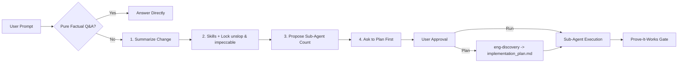
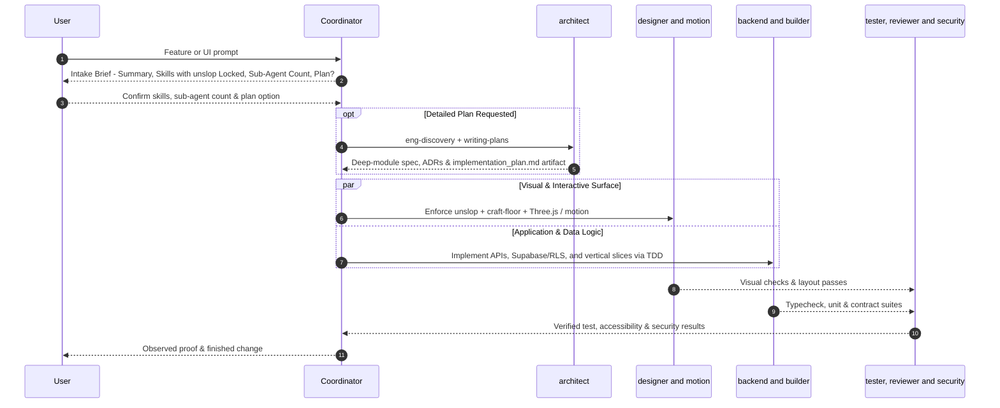
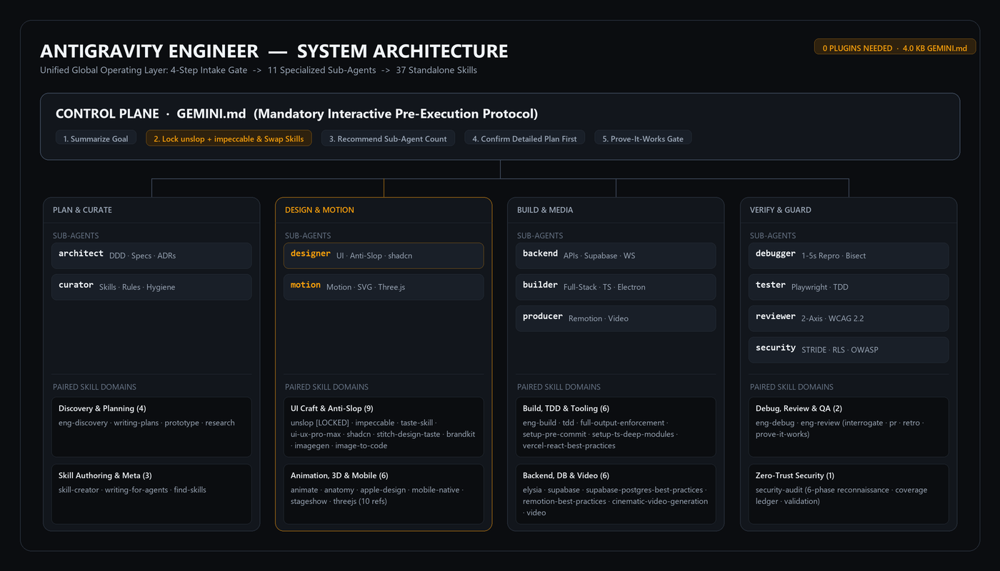
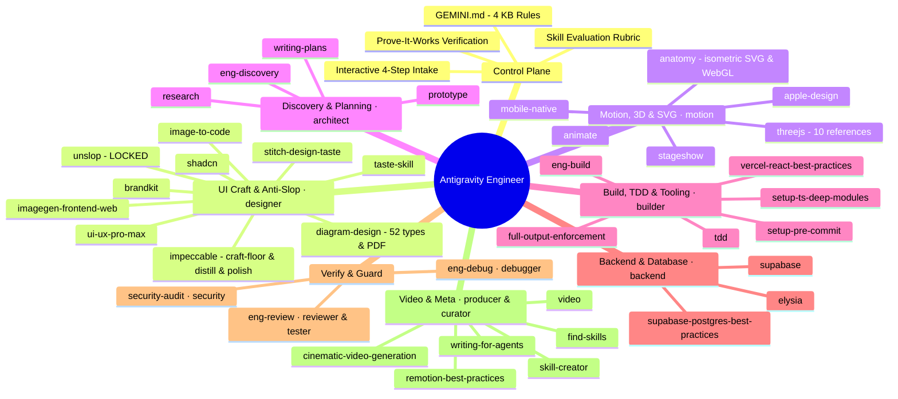

<div align="center">


<br />

[](#skills)
[](#sub-agents)
[](#architecture)
[](#workflow)
[](#install)

<p>
  <strong>11 simple sub-agents, 38 standalone skills, and an interactive anti-slop operating system for Antigravity.</strong>
</p>

<p>
  <a href="#install">Install</a> &nbsp;·&nbsp;
  <a href="#workflow">Workflow</a> &nbsp;·&nbsp;
  <a href="#architecture">Architecture</a> &nbsp;·&nbsp;
  <a href="#sub-agents">Sub-Agents</a> &nbsp;·&nbsp;
  <a href="#skills">Skills</a> &nbsp;·&nbsp;
  <a href="#setup--rollback">Setup & Rollback</a>
</p>

</div>

---

## Install

> [!IMPORTANT]
> **One-Prompt AI Install:** Send this to any Antigravity agent:
> *"Clone `https://github.com/itsjamiedev/Antigravity-Engineer.git` and follow `README.md` to install it globally using clean non-interactive mode, then verify all completion criteria pass."*

<div align="center">
  
</div>

**Scope options:**
- **Global (`~/.gemini/config/`)** — Recommended default. Installs `GEMINI.md`, `11` sub-agents, and `38` skills across every workspace automatically.
- **Global + Workspace (`-Workspace` / `--workspace`)** — Installs globally and mirrors `skills/` into `<project>/.agents/skills/`.
- **Workspace-Only (`-WorkspaceOnly` / `--workspace-only`)** — Deploys `skills/` only into `<project>/.agents/skills/`.

**Windows (PowerShell):**
```powershell
git clone https://github.com/itsjamiedev/Antigravity-Engineer.git
cd Antigravity-Engineer

# Clean global install (creates backup first)
powershell -ExecutionPolicy Bypass -File .\install.ps1 -CleanOldSkills -NonInteractive

# Merge install (keeps existing custom skills)
powershell -ExecutionPolicy Bypass -File .\install.ps1 -Merge -NonInteractive

# Global install + workspace mirror
powershell -ExecutionPolicy Bypass -File .\install.ps1 -CleanOldSkills -NonInteractive -Workspace "C:\path\to\project"

# Workspace only
powershell -ExecutionPolicy Bypass -File .\install.ps1 -WorkspaceOnly -Workspace "C:\path\to\project" -NonInteractive
```

**macOS / Linux / Git Bash:**
```bash
git clone https://github.com/itsjamiedev/Antigravity-Engineer.git
cd Antigravity-Engineer
chmod +x ./install.sh

# Clean global install (creates backup first)
./install.sh --clean-old-skills --non-interactive

# Merge install (keeps existing custom skills)
./install.sh --merge --non-interactive

# Global install + workspace mirror
./install.sh --clean-old-skills --non-interactive --workspace "/path/to/project"

# Workspace only
./install.sh --workspace-only --workspace "/path/to/project" --non-interactive
```

<details>
<summary><strong>Manual Copy Fallback & Verification Checklist</strong></summary>

If script execution is blocked, copy manually:
1. Copy `GEMINI.md` to `~/.gemini/config/GEMINI.md`.
2. If upgrading from an older version, remove legacy hyphenated files in `~/.gemini/config/agents/`: `software-architect.md`, `backend-systems-engineer.md`, `desktop-app-engineer.md`, `ui-ux-designer.md`, `motion-design-engineer.md`, `deep-debugger.md`, `code-reviewer.md`, `qa-automation-engineer.md`, `security-auditor.md`, `video-production-engineer.md`, `skill-architect.md`.
3. Copy all `11` `.md` files from `agents/` into `~/.gemini/config/agents/`.
4. Copy all `38` folders from `skills/` into `~/.gemini/config/skills/` (or `<workspace>/.agents/skills/`).

**Completion criteria:**
| Target | Pass Condition |
| :--- | :--- |
| `skills/` | `>= 38` directories, each with a `SKILL.md` (`name:` + `description:`) |
| `agents/` | `11` 1-word `.md` profiles; `0` legacy hyphenated filenames |
| `GEMINI.md` | Present in `~/.gemini/config/`, no YAML frontmatter, `< 24000` bytes |
| Installer | Exited cleanly with status `0` |

</details>

---

## Workflow

`GEMINI.md` enforces an interactive 4-step pause before planning or editing on every non-trivial task, closing with mandatory **Prove-It-Works** checks.

<div align="center">
  
</div>





> [!TIP]
> **`unslop` + `impeccable` Are Locked on UI Tasks:** Every UI prompt automatically enforces `unslop` and `impeccable` (`craft-floor`, `distill`, `polish`) with zero opt-out—eliminating generic purple templates, nested card clutter, decorative blurs, and sloppy spacing without requiring manual commands.

---

## Architecture

One 4 KB `GEMINI.md` routes **`11` 1-word sub-agents** across **`38` standalone skills**—no separate plugins required.

<div align="center">
  
</div>



---

## Sub-Agents

| Sub-Agent | Owns | Paired Skills | Verification Contract |
| :--- | :--- | :--- | :--- |
| **`architect`** | Specs, DDD, ADRs | `eng-discovery`, `writing-plans`, `prototype`, `diagram-design` | Contracts & file refs checked against live code |
| **`backend`** | APIs, Postgres, Realtime | `eng-build`, `tdd`, `elysia`, `supabase`, `supabase-postgres-best-practices` | Integration tests, query plans & live endpoints |
| **`builder`** | Full-stack & desktop slices | `eng-build`, `tdd`, `full-output-enforcement`, `vercel-react-best-practices`, `setup-ts-deep-modules` | Typecheck, lint, TDD suites & IPC isolation |
| **`designer`** | Visual UI/UX & anti-slop | `unslop` *(locked)*, `impeccable`, `taste-skill`, `diagram-design`, `ui-ux-pro-max`, `shadcn` | Screenshot inspection, PDF/SVG checks & zero slop tells |
| **`motion`** | Motion, 3D WebGL & SVGs | `animate`, `anatomy`, `apple-design`, `mobile-native`, `stageshow`, `threejs` | `film.mjs --gate`, `anatomy --audit`, GPU disposal |
| **`debugger`** | Root-cause diagnostics | `eng-debug` | 1–5s repro loop red -> green + `blast-radius` |
| **`reviewer`** | Two-axis code & WCAG review | `eng-review` | Evidence-backed Strengths, Suggestions & Blockers |
| **`tester`** | Playwright E2E & TDD | `tdd`, `eng-review` | Live test/contract/axe-core runs post-edit |
| **`security`** | Threat modeling & RLS | `security-audit` | Coverage ledger & findings JSON validators |
| **`producer`** | Remotion & explainer video | `remotion-best-practices`, `cinematic-video-generation`, `video` | Timeline/audio audit & frame/video checks |
| **`curator`** | Skills, rules & repo hygiene | `skill-creator`, `writing-for-agents`, `find-skills`, `agy-customizations` | Frontmatter, link checks & 24 KB rule limit |

<details>
<summary><strong>Deep Dive: What Each Sub-Agent Does</strong></summary>

- **`architect`** — Shapes vague prompts into crisp domain models (`GLOSSARY.md`), deep modules with simple seams, ADRs, and tracer-bullet tasks.
- **`designer`** — Owns visual layout, typography, Tailwind/shadcn craft, `diagram-design` infographics/vector PDFs, and mandatory `unslop` + `impeccable` anti-slop passes; delegates motion, Three.js, and isometric 3D SVG rigs to `motion`.
- **`motion`** — Handles restrained CSS/WAAPI transitions (`animate`), pointer-driven spring physics (`apple-design`), touch/viewport ergonomics (`mobile-native`), cursor UI demos (`stageshow`), isometric SVG rigs (`anatomy`), and Three.js WebGL scenes (`threejs`).
- **`backend`** — Implements typed ElysiaJS/Hono routes, Supabase SSR auth, GIN/JSONB indexing, `EXPLAIN (ANALYZE, BUFFERS)` query tuning, and reconnect-safe WebSockets.
- **`builder`** — Delivers complete vertical feature slices across Next.js/React, modular TypeScript packages, and secure Electron IPC apps with zero placeholders.
- **`debugger`** — Runs git archaeology (`why`), isolates failures in tight 1–5s repro loops, resolves layout thrashing/memory leaks, and executes `attack-the-premise` when assumptions break.
- **`reviewer`** — Checks Standards (Fowler smells, React waterfalls, WCAG 2.2) alongside Spec fidelity without scope drift or refactor avalanches.
- **`tester`** — Runs Red-Green-Refactor TDD loops, resilient Playwright locators (`getByRole`, `getByLabel`), API schema tests, and accessibility sweeps.
- **`security`** — Audits server identity extraction (`auth.getUser()`), Postgres RLS `(SELECT auth.uid())`, BOLA/BFLA controls, transaction locking, and Cloudflare's 6-phase audit ledger.
- **`producer`** — Builds React video compositions in Remotion Studio (`remotion-best-practices`) and 2D animated explainers with audio/SFX pipelines (`cinematic-video-generation`).
- **`curator`** — Evaluates new skills against the 4-point Skill Evaluation Rubric, prunes duplicates, keeps `GEMINI.md` under 24 KB, and verifies links/scripts.

</details>

---

## Skills

Every skill resides under `skills/<name>/SKILL.md` with progressive disclosure (`references/`, `scripts/`, `kit/`, `examples/`) loaded strictly on demand.

<details open>
<summary><strong>1. UI Craft, Diagrams & Anti-Slop (10 Skills · <code>designer</code>)</strong></summary>

| Skill | Role | Trigger |
| :--- | :--- | :--- |
| **`unslop`** *(Locked)* | 9-pass redline cleanup (4px spacing grid, single neutral ramp, accent contrast, copy tightening, zero purple/glow slop) + `snapshot.mjs` | Automatically enforced on **every** UI task |
| **`impeccable`** | Full UI craft (`craft-floor`, `distill` decluttering, `polish`, `audit`, `critique`, `harden`) | Auto-paired with `unslop` on UI builds/redesigns |
| **`taste-skill`** | Adjustable layout variance, density, and motion rules for modern product sites | New landing pages & design overhauls |
| **`diagram-design`** | 52-type 4px-grid editorial diagrams, infographics, `.drawio`/Mermaid/`.excalidraw`/PlantUML imports & vector PDF/PNG/SVG export | Architecture, charts, infographics & PDFs |
| **`ui-ux-pro-max`** | Searchable design DB (`84` styles, `192` palettes, `74` font pairings, `25` charts, `22` stacks) | Choosing typography, palettes & charts |
| **`shadcn`** | CLI workflows, `components.json` presets & shadcn/ui debugging | Adding or fixing shadcn/ui components |
| **`stitch-design-taste`** | Semantic `DESIGN.md` design-token and layout generator | Creating/updating project `DESIGN.md` specs |
| **`brandkit`** | Art-direction system for minimalist brand boards & logo systems | Identity decks & visual brand guidelines |
| **`imagegen-frontend-web`** | Section-level web art direction avoiding compressed moodboards | Directing multi-section landing visuals |
| **`image-to-code`** | Converts mockups/screenshots to clean UI without nested-card bloat | Translating screenshots or comps into UI |

</details>

<details open>
<summary><strong>2. Animation, 3D WebGL, SVG & Mobile (6 Skills · <code>motion</code>)</strong></summary>

| Skill | Role | Trigger |
| :--- | :--- | :--- |
| **`animate`** | Frequency-gated UI motion framework (`CSS` -> `@starting-style` -> `WAAPI` -> `Motion`) + reduced-motion | Transitions, micro-interactions & reveals |
| **`anatomy`** | Physical-object isometric SVG explainers (`kit/`, WebGL shaders, `A.settle`, `--audit`, `lines.mjs`) | Interactive diagrams & technical figures |
| **`apple-design`** | Zero-latency pointer tracking, interruptible springs & translucent depth | Drag/swipe gestures, sheets & spring UI |
| **`mobile-native`** | Fixes web-on-phone tells (`(hover: hover)`, `dvh`, safe-area insets, `16px+` inputs) | Mobile layouts, PWAs & touch components |
| **`stageshow`** | Faux product UI & cursor walkthrough React kit verified with `film.mjs --gate` | Product demos, bento grids & feature cards |
| **`threejs`** | Consolidated Three.js router covering `fundamentals`, `geometry`, `materials`, `lighting`, `textures`, `animation`, `loaders`, `shaders`, `postprocessing`, and `interaction` | 3D scenes, GLTF viewers, GLSL & WebGL |

</details>

<details>
<summary><strong>3. Discovery, Planning & Research (4 Skills · <code>architect</code>)</strong></summary>

| Skill | Role | Trigger |
| :--- | :--- | :--- |
| **`eng-discovery`** | `reframe`, `sharpen`, `grill-with-docs`, `GLOSSARY.md` & ADRs, tracer-bullet slicing | Architecture planning & ambiguous prompts |
| **`writing-plans`** | Step-by-step pre-code implementation planning template | Approved detailed planning steps |
| **`prototype`** | Throwaway isolated HTML/route prototypes to settle competing designs | Empirical UX or state-model checks |
| **`research`** | Primary-source investigation verifying docs/APIs before capturing Markdown specs | Deep library/API research tasks |

</details>

<details>
<summary><strong>4. Build, TDD & Engineering Tooling (6 Skills · <code>builder</code> / <code>tester</code>)</strong></summary>

| Skill | Role | Trigger |
| :--- | :--- | :--- |
| **`eng-build`** | 24 engineering principles, clean module boundaries & sub-agent slice execution | Feature builds, refactors & migrations |
| **`tdd`** | Red -> Green -> Refactor workflow testing observable behavior (`tests.md`, `mocking.md`) | Test-first development & bug regression tests |
| **`full-output-enforcement`** | Bans `// TODO` stubs & truncated code—complete production files only | All code-generation tasks |
| **`vercel-react-best-practices`** | React & Next.js optimization rules covering waterfalls, bundles & re-renders | Authoring/auditing React & Next.js apps |
| **`setup-pre-commit`** | Husky + `lint-staged` Prettier, typecheck & test pre-commit hook setup | Bootstrapping repo commit hooks |
| **`setup-ts-deep-modules`** | Wires `dependency-cruiser` to enforce entry-point-only TS module seams | Enforcing modular TS package boundaries |

</details>

<details>
<summary><strong>5. Backend & PostgreSQL / Supabase (3 Skills · <code>backend</code>)</strong></summary>

| Skill | Role | Trigger |
| :--- | :--- | :--- |
| **`elysia`** | Type-safe ElysiaJS routes, schema validation, plugins & `Eden Treaty` clients | ElysiaJS backend endpoints & services |
| **`supabase`** | `@supabase/ssr` auth, migrations, RLS policies, Realtime, Storage & Edge Functions | Supabase features, auth & schema changes |
| **`supabase-postgres-best-practices`** | Index strategy, JSONB GIN optimization, pooling & lock-safe SQL tuning | Postgres schema design & query optimization |

</details>

<details>
<summary><strong>6. Debugging, Code Review & Security (3 Skills · <code>debugger</code> / <code>reviewer</code> / <code>security</code>)</strong></summary>

| Skill | Role | Trigger |
| :--- | :--- | :--- |
| **`eng-debug`** | Git `why` archaeology, 1–5s repro loops, `attack-the-premise` & `blast-radius` checks | Hard bugs, regressions & risky changes |
| **`eng-review`** | Adversarial diff interrogation (`interrogate`), PR briefings (`pr`), `retro` & `prove-it-works` | Code review & pre-merge verification |
| **`security-audit`** | Cloudflare's 6-phase audit pipeline (`coverage-ledger.json`, `findings.json`, validators) | Auth/RLS checks, threat modeling & audits |

</details>

<details>
<summary><strong>7. Video & Remotion (3 Skills · <code>producer</code>)</strong></summary>

| Skill | Role | Trigger |
| :--- | :--- | :--- |
| **`remotion-best-practices`** | 12-in-1 Remotion router (scaffolding, Studio, captions, maps, `<Player>`, CLI render) | Programmatic React video compositions |
| **`cinematic-video-generation`** | 2D explainer video pipeline (themes, VO/TTS, SFX, timeline audit & 1080p CRF 14 render) | Product explainer & launch videos |
| **`video`** | Direct `/video` entry shortcut to `cinematic-video-generation` | Quick `/video` invocation |

</details>

<details>
<summary><strong>8. Skill Authoring & Meta (3 Skills · <code>curator</code>)</strong></summary>

| Skill | Role | Trigger |
| :--- | :--- | :--- |
| **`skill-creator`** | Scaffold, benchmark & optimize `SKILL.md` skills cleanly | Creating or refining custom skills |
| **`writing-for-agents`** | Agent-doc craft: context load budgets, progressive disclosure & leading words | Editing `AGENTS.md` or `SKILL.md` |
| **`find-skills`** | Ecosystem discovery workflow for locating installable capabilities | Searching for existing skills |

</details>

---

## Setup & Rollback

```text
Antigravity-Engineer/
├── GEMINI.md            # Global rules, 4-step intake gate & Skill Evaluation Rubric
├── install.ps1          # Windows PowerShell installer
├── install.sh           # macOS / Linux / Git Bash installer
├── README.md            # Repository guide
├── assets/              # Official-logo hero banner, architecture map & GIF demos
├── agents/              # 11 simplified 1-word sub-agent profiles
└── skills/              # 38 standalone progressive-disclosure skills
```

**Optional CLI Tools** *(all skills are pure Markdown unless executing helper scripts)*:
- **Node.js 20.10+**: Required for `anatomy` (`kit/` builds & `--audit`), `security-audit` JSON validators, and `remotion-best-practices`.
- **Python 3 + Playwright (`pip install playwright && playwright install chromium`) & `ffmpeg`**: Required for `diagram-design` (`export_pdf.py`, `export_png.py`), `unslop` (`snapshot.mjs`), `stageshow` (`film.mjs --gate`), and `anatomy` (`lines.mjs`).
- **`impeccable` CLI**: Optional (`npx impeccable`) for local doctor checks.

<details>
<summary><strong>Backups & Rollback Commands</strong></summary>

Both `install.ps1` and `install.sh` automatically back up `~/.gemini/config` to `~/.gemini/config-backup-<YYYYMMDD-HHMMSS>` before making edits (unless `-SkipBackup` / `--skip-backup` is passed).

```powershell
# Windows restore
Copy-Item "$HOME\.gemini\config-backup-<timestamp>\*" "$HOME\.gemini\config\" -Recurse -Force
```

```bash
# macOS / Linux restore
cp -R ~/.gemini/config-backup-<timestamp>/. ~/.gemini/config/
```

</details>
